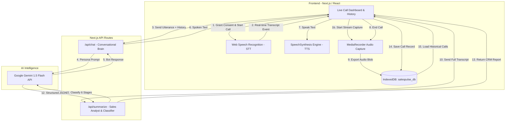

# SalesPulse AI — AI Voice Sales Bot

[](https://sankar-group-assignment-7udocyxf7-krishu2814.vercel.app/)
[](https://nextjs.org/)
[](https://www.typescriptlang.org/)

> 🌐 **Live Website Link**: [https://sankar-group-assignment-7udocyxf7-krishu2814.vercel.app/](https://sankar-group-assignment-7udocyxf7-krishu2814.vercel.app/)

An interactive, production-ready AI voice sales bot built for the **Sankar Group Intern Assignment**. SalesPulse conducts real-time sales phone calls with prospects to pitch B2B SaaS software, listens and understands responses, displays live transcripts, records calls with user consent, and generates automated CRM sales summaries with 6-stage deal qualification.


---

## 🚀 Key Features

1. **Interactive Voice Conversation**: Understands customer speech, answers questions, handles common sales objections (pricing, competitors, security), and guides the prospect toward conversion.
2. **Real-time Live Chat Feed**: Streams user utterances and AI responses instantaneously on screen with interim speech transcription.
3. **Call Controls & Status**: Start/End call buttons, active call duration counter, mute toggle, and dynamic status badges (`Idle`, `Connecting`, `In Call`, `Processing`, `Completed`).
4. **Call Recording with Consent**: Audio recording via browser `MediaRecorder` API with an upfront consent dialog and immediate post-call audio playback.
5. **AI-Powered CRM Summary**: Automatically extracts conversation overview, customer requirements, objections raised, and recommended next steps.
6. **Sales Status Classification**: Automatically classifies calls into one of six stages:
   - `Converted` — Customer agreed to purchase or subscribe.
   - `Interested` — Customer engaged positively and showed interest.
   - `Follow-up Required` — Customer needs team approval or requested materials.
   - `Not Interested` — Customer explicitly declined or is out of budget.
   - `Demo Requested` — Customer scheduled or requested a live walkthrough.
   - `No Response` — Customer was silent or did not speak.
7. **Call History & Audio Persistence**: Fully persistent session history using client-side **IndexedDB**, preserving audio recordings as binary Blobs and transcripts across page reloads.
8. **Anti-Echo Feedback Prevention**: Programmatically mutes microphone listening while the AI voice is speaking to prevent self-transcription and audio echo loops.
9. **Interactive Product Blueprint**: Embedded modal detailing the B2B SaaS product (*CloudPulse AI*), pricing tiers, and recommended voice prompts to test during calls.

---

## 🛠️ Technology Stack

| Layer | Technology | Rationale & Interview Talking Point |
| :--- | :--- | :--- |
| **Framework** | **Next.js 14 (App Router) + React 18 + TypeScript** | Full-stack architecture with serverless API routes, strong typing, and 1-click Vercel deployment readiness. |
| **Styling** | **Tailwind CSS + Lucide Icons** | Sleek dark-mode dashboard with responsive layouts and glowing status indicators. |
| **Speech-to-Text (STT)** | **Web Speech API (`SpeechRecognition`)** | Zero-latency browser-native speech recognition streaming interim user utterances. |
| **Text-to-Speech (TTS)** | **Web Speech Synthesis API (`SpeechSynthesis`)** | Natural voice synthesis with automatic voice selection and markdown cleaning. |
| **Audio Capture** | **Browser `MediaRecorder` API** | Captures audio stream directly from user microphone as `audio/webm` chunks. |
| **AI Brain** | **Google Gemini API (`gemini-1.5-flash`)** | Low-latency LLM intelligence with structured JSON output and built-in offline rule-based fallback. |
| **Data Persistence** | **IndexedDB (`salespulse_db`)** | Browser database storing binary audio Blobs and call records without the 5MB quota limits of localStorage. |

---

## 📐 System Architecture



---

## 📦 Getting Started

### 1. Prerequisites
- Node.js `v18+` or `v20+` (tested on Node `v22`)
- npm `v9+` or `v10+`
- A Chromium-based browser (Google Chrome, Microsoft Edge, Brave) or Safari for native Web Speech API support.

### 2. Installation
```bash
git clone https://github.com/krishu2814/Sankar-Group-Assignment.git
cd Sankar-Group-Assignment
npm install
```

### 3. Environment Configuration
Create a `.env.local` file from the template:
```bash
cp .env.example .env.local
```
Add your Google Gemini API key:
```env
GEMINI_API_KEY=your_gemini_api_key_here
```
*(Note: A smart rule-based fallback mode is built-in, allowing full end-to-end testing even without an API key!)*

### 4. Run Development Server
```bash
npm run dev
```
Open [http://localhost:3000](http://localhost:3000) in your browser.

### 5. Build for Production
```bash
npm run build
npm run start
```

---

## 🎙️ Interactive Testing Prompts

When on a voice call with Alex, try speaking these real-world sales scenarios:

- **Competitor Comparison**: *"We already use Datadog and CloudWatch. Why should we switch?"*
- **Pricing & Budget**: *"How much does CloudPulse cost per month?"*
- **Live Demo Request**: *"Can we schedule a 15-minute live demo on Thursday?"*
- **Direct Conversion**: *"I want to sign up for the Starter plan right now."*
- **Objection**: *"We need to discuss this with our engineering team lead first."*
- **Disinterest**: *"We are not interested right now, thank you."*

---

## 📄 License
MIT License. Built for the Sankar Group Internship Assignment.
